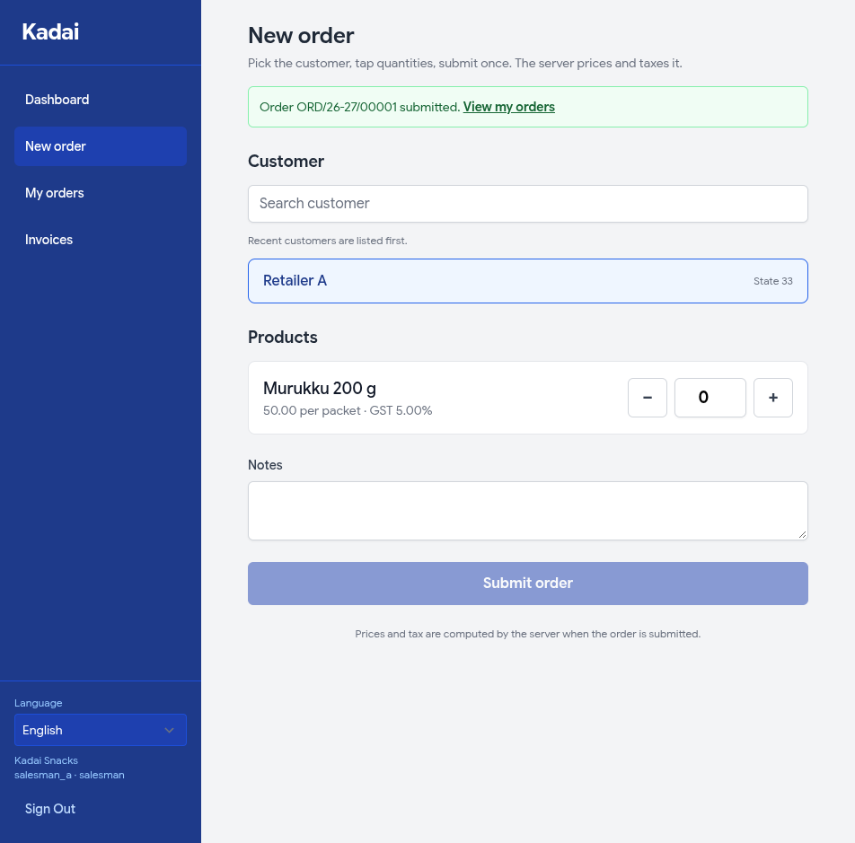
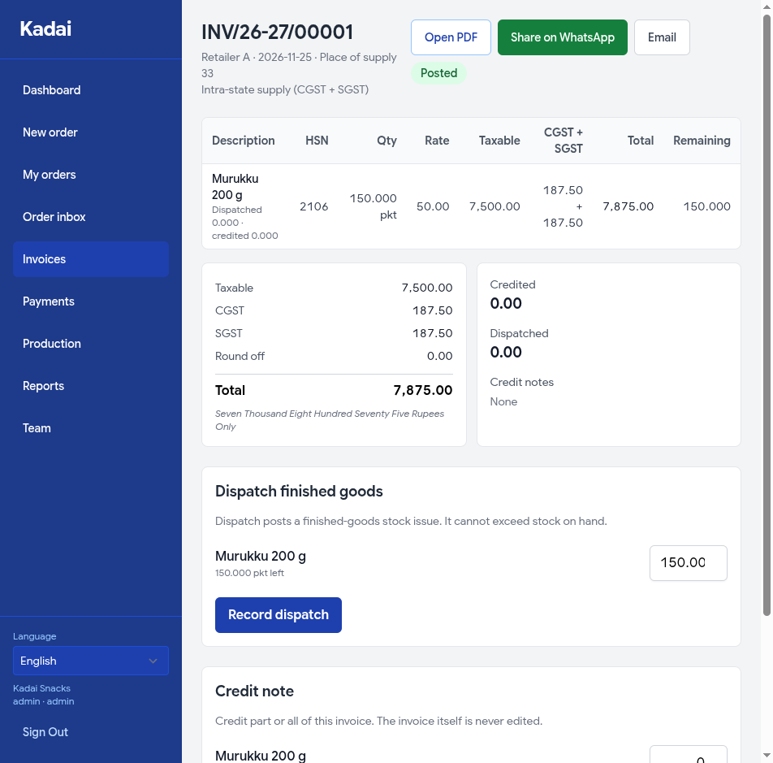
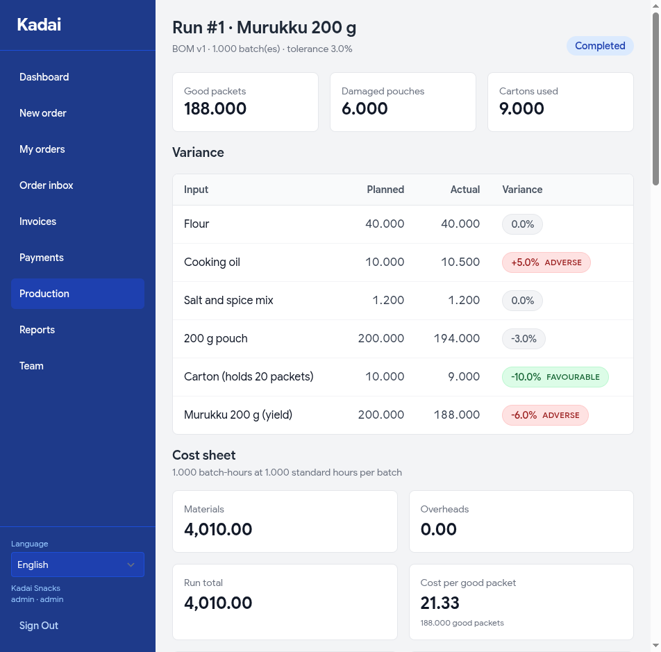

# Kadai — Order-to-Audit System

> NIT Tiruchirappalli CDI Winter Internship 2026 · Prototype for a South Indian snack factory

## Live deployment

Kadai is packaged for a free-tier managed deployment:

```
Browser → Cloudflare Worker (React build + /api proxy) → Render (Django/gunicorn) → Neon (PostgreSQL 16)
```

| Piece | Service | Role |
|-------|---------|------|
| SPA and `/api` forwarder | Cloudflare Workers | Serves the built React app and proxies only `/api/*` to Django |
| API and invoice PDFs | Render (free Docker plan) | Gunicorn, WhiteNoise, migrations on boot, `render.yaml` |
| Database | Neon (free) | PostgreSQL 16 through the pooled connection string |

Deploys run from `main` only after CI passes; pull requests never deploy. The
full runbook, environment variables and smoke tests are in
[`docs/DEPLOYMENT.md`](docs/DEPLOYMENT.md).

> **Live URL:** add the Cloudflare Worker URL or custom domain here after the
> first deploy. Use the same origin for the `SITE_URL` repository variable and
> Render's `CSRF_TRUSTED_ORIGINS`.

### Go-live checklist

- [ ] Neon pooled `DATABASE_URL` uses `sslmode=require`.
- [ ] Render has `SECRET_KEY`, `ALLOWED_HOSTS`, `CSRF_TRUSTED_ORIGINS`,
      `SITE_URL`, the SMTP variables and the same `TRUSTED_PROXY_SECRET` as the
      Worker.
- [ ] The Cloudflare Worker has `API_ORIGIN` and the `TRUSTED_PROXY_SECRET`
      secret.
- [ ] `curl -fsS https://<worker>/api/health/` returns `{"status": "ok"}`.
- [ ] Register the first organization, or run `bootstrap_admin` once, then invite
      an admin from **Team**.
- [ ] Place one order through dispatch, open the invoice PDF and confirm the
      totals.
- [ ] Configure a backup (Neon restore window or a scheduled `pg_dump`).

## Quick Start

```bash
cp .env.example .env
make up      # starts db + api + web
make migrate # run migrations
make seed    # load benchmark data
```

Then open http://localhost:3000

## Development Logins

These users come from `make seed` and exist **only in the development/CI
database**. Never run the seed command against production.

| Role | Username | Password |
|------|----------|----------|
| Salesman A | salesman_a | salesman_a |
| Salesman B | salesman_b | salesman_b |
| Admin | admin | admin |
| Production | production | production |
| Accountant | accountant | accountant |
| Owner | owner | owner |

## Production deployment

Two deployment paths are supported.

### Managed free tier (Cloudflare + Render + Neon)

The React app and a `/api` forwarder run on Cloudflare Workers, the Django API
runs on Render's free Docker plan, and PostgreSQL runs on Neon. See
[`docs/DEPLOYMENT.md`](docs/DEPLOYMENT.md) for the step-by-step guide,
environment variables, owner bootstrap and smoke tests. `render.yaml` describes
the Render service; `frontend/wrangler.jsonc` and `frontend/worker/index.ts`
describe the Worker.

Pushes to `main` run CI first and then deploy the API and Worker through
GitHub Actions (`.github/workflows/ci.yml`). Pull requests run the same checks
without deploying. Repository variables, secrets and the Render deploy hook are
documented in the deployment guide.

A fresh production database has no users. Visitors create their own
organization at `/register`; the creator becomes that organization's owner.
The owner can then invite admins from the **Team** screen, and each admin can
invite salesmen, accountants and production staff. Invitations are sent by
email and accepted at `/invite/<token>`.

For an existing deployment that needs a default organization and owner, run
the bootstrap command once:

```bash
ADMIN_USERNAME=owner ADMIN_PASSWORD='a-long-unique-password' \
  python manage.py bootstrap_admin
```

Configure SMTP in production with `EMAIL_HOST`, `EMAIL_PORT`,
`EMAIL_HOST_USER`, `EMAIL_HOST_PASSWORD`, `DEFAULT_FROM_EMAIL` and `SITE_URL`;
without them Django uses the console email backend and invitations are written
to the server log. See [`docs/DEPLOYMENT.md`](docs/DEPLOYMENT.md).

### Self-hosted Docker Compose

```bash
cp .env.example .env      # fill in the production values
make up-prod               # docker compose -f docker-compose.prod.yml up --build -d
```

The production stack differs from development:

- API runs under **gunicorn** with `config.settings.production`, not `runserver`.
- `SECRET_KEY`, `ALLOWED_HOSTS` and `DATABASE_URL` are mandatory; the container
  refuses to start without them and rejects `ALLOWED_HOSTS=*`.
- Secure cookies are always on. Set `SECURE_SSL_REDIRECT=true` and
  `SECURE_HSTS_SECONDS=31536000` once TLS terminates in front of `web`.
- The **Benchmark Console, its API and the seed/run commands are disabled**.
- Static admin assets are served by WhiteNoise; nginx adds CSP and security
  headers, gzip, immutable asset caching and the `/api/` proxy.
- `make check-deploy` runs Django's production checks.

Django's admin site is intentionally not routed through the public nginx
config in the self-hosted stack; reach it from inside the network if you need
it. In the managed deployment it is available on the Render hostname at
`/admin/`.

## Stack

| Layer | Choice |
|-------|--------|
| Backend | Python 3.12, Django 5.2, DRF |
| Database | PostgreSQL 16 |
| Frontend | React 18, TypeScript, Vite |
| Auth | Django session auth |
| PDF | WeasyPrint |
| Tests | pytest-django, Vitest, Playwright |
| Run (local and self-hosted) | Docker Compose |
| Managed deploy | Cloudflare Workers + Render + Neon |

## Commands

| Command | What it does |
|---------|-------------|
| `make up` | Start the development stack |
| `make down` | Stop the development stack |
| `make up-prod` | Start the self-hosted production stack |
| `make down-prod` | Stop the production stack |
| `make logs-prod` | Tail production logs |
| `make check-deploy` | Run Django's production checks |
| `make seed` | Load benchmark data |
| `make seed-reset` | Reset and reload benchmark data |
| `make test` | Run backend tests |
| `make check` | Lint + typecheck + test |
| `make benchmark` | Run benchmark scenario |
| `make reconcile` | Check ledger consistency |
| `make shell` | Django shell |
| `make psql` | PostgreSQL shell |
| `make logs` | Tail service logs |

## Feature Status

| Feature | Status |
|---------|--------|
| Project scaffold | ✅ Phase 0 |
| Masters, units, ledger, stock API | ✅ Phase 1 |
| Production loop (BOM, purchases, runs, variance, amend) | ✅ Phase 2 |
| Sales loop (orders, invoices, dispatch, credit notes, payments) | ✅ Phase 3 |
| Costing (overheads, cost sheet, FG cost and margin) | ✅ Phase 4 |
| Reports, exports, reconciliation and owner dashboard | ✅ Phase 5 |
| Leakage Radar (report card, bridge, drift, leakage tile) | ✅ Phase 6 |
| Loop Closer (shortage → batches → purchase) | ✅ Phase 6 |
| Benchmark harness (CLI and CI only; disabled in production) | ✅ Phase 6 |
| Offline ordering (IndexedDB cache, outbox, pending badge, sync) | ✅ Phase 7 |
| Low-stock alerts (per-item reorder level) | ✅ Phase 7 |
| Tamil UI (language switcher, all screens) | ✅ Phase 7 |
| Organization onboarding (self-registration, email invites, per-org data) | ✅ Phase 8 |
| Production hardening (gunicorn, WhiteNoise, CSP, login throttle, prod settings) | ✅ Phase 8 |
| Managed deployment (Cloudflare + Render + Neon, CI/CD) | ✅ Phase 8 |

## Screenshots

| Salesman order (mobile) | Invoice with GST | Run variance and cost |
|---|---|---|
|  |  |  |

## Phase 1 Inventory API

| Method | Path | Allowed roles |
|--------|------|---------------|
| GET | `/api/inventory/stock/` | all five roles |
| GET | `/api/inventory/ledger/?item=&date_from=&date_to=` | admin, production, accountant, owner |
| POST | `/api/inventory/adjustments/` | admin, production, owner |

The stock ledger is append-only (a PostgreSQL trigger rejects UPDATE and DELETE).
Opening balances are `OPENING` ledger rows, so the stock summary is literally a
sum over the ledger. `make seed` loads the Appendix A opening stock and
`make reconcile` proves every balance equals its ledger sum.

## Phase 2 Production API

| Method | Path | Allowed roles |
|--------|------|---------------|
| GET | `/api/production/boms/?product=` | production, admin, accountant, owner |
| POST | `/api/production/boms/` | production, admin, owner |
| GET | `/api/production/runs/?product=` | production, admin, accountant, owner |
| POST | `/api/production/runs/` | production, admin, owner |
| GET | `/api/production/runs/<id>/` | production, admin, accountant, owner |
| POST | `/api/production/runs/<id>/issue/` | production, admin, owner |
| POST | `/api/production/runs/<id>/complete/` | production, admin, owner |
| POST | `/api/production/runs/<id>/amend/` | production, admin, owner |
| POST | `/api/inventory/purchases/` | production, admin, owner |

The run screen lives at `/production` in the web app (tablet-sized numeric
inputs, live variance chips, stored variance table once completed).

## Phase 3 Sales & Payments API

| Method | Path | Allowed roles |
|--------|------|---------------|
| GET | `/api/masters/customers/` | salesman (assigned only), admin, accountant, owner |
| GET | `/api/masters/items/?type=FG&customer=` | all five roles |
| GET | `/api/sales/orders/?state=&customer=` | salesman (own only), admin, accountant, owner |
| POST | `/api/sales/orders/` | salesman, admin, owner |
| GET | `/api/sales/orders/<id>/` | salesman (own only), admin, accountant, owner |
| GET | `/api/sales/orders/<id>/coverage/` | admin, accountant, owner |
| PATCH | `/api/sales/orders/<id>/lines/<line_id>/` | admin, owner |
| POST | `/api/sales/orders/<id>/approve/` | admin, owner |
| POST | `/api/sales/orders/<id>/reject/` | admin, owner |
| POST | `/api/sales/orders/<id>/invoice/` | admin, owner |
| GET | `/api/sales/invoices/` | salesman (own only), admin, accountant, owner |
| GET | `/api/sales/invoices/<id>/` | salesman (own only), admin, accountant, owner |
| GET | `/api/sales/invoices/<id>/pdf/` | admin, accountant, owner |
| GET | `/api/sales/invoices/pdf/<token>/` | anyone with the signed, expiring link |
| GET | `/api/sales/invoices/<id>/share/` | admin, owner |
| POST | `/api/sales/invoices/<id>/dispatch/` | admin, owner |
| POST | `/api/sales/invoices/<id>/credit-notes/` | admin, owner |
| GET | `/api/payments/payments/?customer=` | admin, accountant, owner |
| POST | `/api/payments/payments/` | admin, owner |
| GET | `/api/payments/outstanding/?customer=` | admin, accountant, owner |
| GET | `/api/payments/ageing/?customer=&as_of=` | admin, accountant, owner |
| GET | `/api/payments/customers/<id>/ledger/` | admin, accountant, owner |

The salesman screens are `/orders/new` and `/orders` (mobile-first, 44 px touch
targets). The admin screens are `/admin/orders` (stock-coverage chips, audited
quantity/price edits, approve/reject, invoice), `/invoices` (PDF, WhatsApp and
mailto share links, dispatch, credit notes) and `/payments` (allocation,
outstanding, ageing and the customer ledger).

## Phase 4 Costing API

| Method | Path | Allowed roles |
|--------|------|---------------|
| GET | `/api/costing/runs/<id>/` | production, admin, accountant, owner |
| POST | `/api/costing/runs/<id>/overheads/` | production, admin, owner |
| GET | `/api/costing/monthly-overheads/?period=` | production, admin, accountant, owner |
| POST | `/api/costing/monthly-overheads/` | production, admin, owner |
| POST | `/api/costing/monthly-overheads/allocate/` | admin, owner |
| GET | `/api/costing/products/<id>/` | production, admin, accountant, owner |

The completed-run screen at `/production/runs/<id>` now carries the cost sheet:
materials by input, overheads, run total, cost per good packet, selling price,
margin and the current finished-goods weighted-average cost. Production, admin
and owner can add labour, gas/power or other overheads from the same screen.

## Phase 5 Reports API

| Method | Path | Allowed roles |
|--------|------|---------------|
| GET | `/api/reports/` | admin, production, accountant, owner |
| GET | `/api/reports/<slug>/?date_from=&date_to=&format=json\|csv\|excel\|pdf` | admin, production, accountant, owner |
| GET | `/api/reports/reconciliation/?date_from=&date_to=` | admin, production, accountant, owner |
| GET | `/api/reports/dashboard/` | admin, accountant, owner |

The report console lives at `/reports`; `/` shows the owner dashboard for
admin, accountant and owner, and sends the production role to `/production`
(the dashboard endpoint is staff-only). The ten
reports are the sales register, sales by customer, sales by product, GST summary
(GSTR-1 shaped, with a GSTR-3B outward-supply figure), purchase register, stock
summary, stock ledger, production report, collections and outstanding/ageing.
Every report accepts a business-date range and exports to CSV, Excel and PDF
from the same rows the screen shows. Reconciliation runs three checks: every
stock balance equals its ledger sum, every invoice total equals its line sum,
and the sales register's taxable total equals the GST summary's taxable total.

## Phase 6 USP API

| Method | Path | Allowed roles |
|--------|------|---------------|
| GET | `/api/production/runs/<id>/report-card/` | production, admin, accountant, owner |
| GET | `/api/production/products/<id>/leakage/` | production, admin, accountant, owner |
| GET | `/api/sales/orders/<id>/coverage/` | admin, accountant, owner (now carries `loop_closers`) |
| POST | `/api/benchmark/run/` | admin, owner (development/CI only) |

`make benchmark` (or `python manage.py run_benchmark`) replays Appendix A
through the same services the API uses and prints every expected value with a
PASS/FAIL verdict; it exits non-zero on any mismatch and runs in a transaction
that is rolled back, so it never leaves benchmark data behind. This harness is
a development and CI tool: production settings disable the API, the seed
command and the run command, and the browser console is not routed. The run screen
at `/production/runs/<id>` shows the Leakage Radar report card and its
cost-per-packet bridge, the ingredient trends and drift alerts. The admin order
inbox shows the Loop Closer panel on a shortage, including the limiting input
and a one-click planned production run.

## Phase 7 Offline PWA and small wins

The salesman app is installable and keeps working without a connection:

- **Cached catalog.** Customer and priced-catalog responses are written through
  to IndexedDB (`kadai` database, Dexie). The catalog row carries the price-list
  version it belongs to and the fetch time, so the order screen opens with the
  last data the server sent.
- **Outbox.** A submit while offline (or a request that fails before it reaches
  the server) is queued locally under the order's own `client_uuid`. The queue
  survives a reload; retries reuse the same UUID, so the existing idempotent
  `POST /api/sales/orders/` can never create a duplicate.
- **Sync.** The outbox flushes on mount, on the browser `online` event, when the
  service-worker Background Sync tag wakes the page, and from the **Sync now**
  button. Network failures keep the queue; a refused order stays queued with the
  server's message.
- **Visibility.** The sidebar shows an offline banner, a `Pending (n)` badge and
  sync failures for every role.
- **Price-list drift.** `GET /api/sales/orders/<id>/coverage/` now returns each
  line's `current_price` and `price_changed`. The admin inbox shows
  "Price list changed: now ₹…" beside the snapshotted price, so an order taken
  against yesterday's list is approved knowingly (the order itself is never
  repriced).
- **Low-stock alerts.** `Item.reorder_level` is a NUMERIC(14,3) master field.
  The dashboard flags a raw or packaging item below its own level; when the
  level is zero it falls back to one batch's BOM requirement, and finished goods
  fall back to zero stock. The benchmark seed sets one batch as each input's
  level, so the Appendix A closings still show no alerts.
- **Tamil UI.** The language switcher in the sidebar toggles English/தமிழ் and
  remembers the choice in `localStorage`; every screen already routes its copy
  through react-i18next, including the production run screen.

The worker (`frontend/src/sw.js`) only precaches the app shell and relays the
Background Sync wake-up; API responses are never cached by the service worker
and all order data offline comes from IndexedDB.

## Sales loop

An order is submitted once per device-generated `client_uuid`; a retry returns
the same order. Prices are resolved from the customer's price list (then the
default list) and snapshotted on the line, so later price changes never rewrite
an existing order or invoice. The state machine is
`SUBMITTED → APPROVED → INVOICED → DISPATCHED`, or `SUBMITTED → REJECTED`, and
every transition writes an `audit_log` row in the same transaction.

Invoices are numbered `INV/26-27/00001` from a row-locked per-financial-year
counter (1 April, Asia/Kolkata), carry CGST + SGST intra-state or IGST
inter-state rounded per line to paise, and show round-off separately. A posted
invoice is immutable: a database trigger rejects UPDATE and DELETE. A credit
note (`CN/26-27/00001`) is the only correction, with an optional restock that
posts a finished-goods `RECEIPT` sourced to the credit note. Dispatch posts
finished-goods `ISSUE` rows and is hard-blocked beyond on-hand stock.

Payments may be partly unallocated. Allocations are locked and can never exceed
an invoice's outstanding balance. Outstanding = invoice total − credit notes −
allocations; ageing buckets are 0–30, 31–60, 61–90 and 90+ days by invoice date.

## Production loop

A purchase posts one `RECEIPT` row per line and updates the moving weighted
average. A run moves `DRAFT → ISSUED → COMPLETED`: issuing posts one `ISSUE`
row per raw material, completing records the packing result, posts the derived
pouch and carton issues plus the finished-goods `RECEIPT`, and stores a
variance snapshot (one row per input plus the yield). Every transition writes
an `audit_log` row in the same transaction. The Production screen at
`/production` plans a draft run from the current BOM, then issues materials
and records the packing result on the run screen.

## Assumptions

See [DESIGN.md](docs/DESIGN.md) for full assumptions and design decisions.
Phase 2 adds these readings of Appendix A:

1. **Packaging is consumed at packing, not pre-issued.** Step 2 issues raw
   materials only; step 3 derives pouches (`good + damaged`) and cartons
   (`cartons used`). This is what makes the pouch line 194 against a plan of
   200, and it needs no reversal to reach the 306 and 21 closings.
2. **Issued but unused stock is returned at its issue value.** If a supervisor
   issues the full plan and uses less, completion posts a `RECEIPT` for the
   difference at the original weighted-average value. Raw-material actual
   usage equals what was issued; leftovers are a stock adjustment.
3. **A completed run is a closed cost document.** `amend` is accepted only
   while a run is `ISSUED`: it reverses every issue at its original value,
   returns the run to `DRAFT` and is audited. Correcting a completed run is a
   later-phase reversal document.
4. **The finished-goods receipt is valued at the run's net material cost**, so
   scrap is absorbed by good packets (assumption A5). Overheads entered after
   completion post a value-only adjustment to the run, so the FG receipt stays
   at material cost and the cost sheet adds the overheads.

Phase 3 adds these readings:

5. **Approval does not hard-block on stock.** The admin may approve and hold an
   order for production; dispatch is the hard gate and refuses to take stock
   below zero. The inbox shows the shortage so the admin can also reduce or
   reject the order.
6. **Invoice cancellation is derived.** Credit notes are append-only; an
   invoice counts as cancelled when credited quantities cover every line. The
   invoice and its lines are never updated, which is what the trigger enforces.
7. **Round-off is a memo line.** The invoice total is exactly taxable + CGST +
   SGST (or taxable + IGST); `round_off` reports the accumulated per-line paise
   rounding and does not change the total.
8. **Credit-note restock is valued at the current weighted-average cost** of
   the finished good (zero if the item has no stock left), so a return cannot
   inflate finished-goods value above cost.
9. **Payments are explicitly allocated.** An unallocated payment is an advance;
   allocations are checked against each invoice's outstanding balance. Ageing
   buckets by invoice date, not by a FIFO payment waterfall.
10. **Shared invoice links expire.** The WhatsApp/mailto link carries a
    Django-signed invoice id valid for seven days and needs no session, so a
    customer can open the PDF without API access.

Phase 4 adds these costing readings:

11. **Overheads enter finished-goods value without quantity.** A run overhead
    posts an append-only `ADJUSTMENT` ledger row with `qty = 0`, so the stock
    balance keeps its packet count and gains the overhead value. The run's
    cost sheet therefore includes overheads even though they arrive after the
    FG receipt. If the FG balance is already zero, the service refuses the
    entry rather than creating value with no stock.
12. **Monthly pools follow batch-hours.** A monthly overhead is split across
    the runs completed in that month (Asia/Kolkata) by
    `batches × standard_batch_hours`; the default standard is one hour per
    batch. A largest-remainder split keeps every share in whole paise and the
    shares sum exactly to the pool. Allocation is idempotent per entry and run.
13. **Run cost and stock cost are different views.** Cost per packet is
    `(net materials + overheads) / good packets`. FG weighted-average cost is
    the current stock value divided by current packets, so it also reflects
    opening FG valuation, dispatches and the timing of overhead entries.
14. **Margin uses the default price list.** The cost sheet compares cost per
    packet with the default selling price; if no price is configured, the
    margin is null rather than invented.

Phase 5 adds these reporting readings:

15. **Reports filter on the business date.** Sales use the invoice date,
    purchases the purchase date, collections the payment date, production the
    completion date and the ledger its entry date. The stock summary is a live
    balance and the ageing report is "as of" the end date (today by default),
    so both say so in their metadata.
16. **The sales register is gross and shows cancellations.** A fully credited
    invoice stays visible with status `cancelled`; credit notes are reported
    separately in the GST summary. Reconciliation compares the register's
    invoice taxable total with the B2B plus B2C taxable totals, and the
    GSTR-3B outward-supply figure is net of credit notes.
17. **Reorder lines come from the BOM.** A raw or packaging item is flagged
    when on-hand stock is below one batch's BOM requirement; finished goods
    are flagged only at zero. This avoids inventing a reorder-level master
    field before Phase 7.
18. **The dashboard's "today" is the Asia/Kolkata business day.** Timestamps
    stay in UTC; the day bounds are converted to IST before counting orders.
19. **Reports are staff-only.** Admin, production, accountant and owner may
    read reports; the salesman is denied because the reports aggregate other
    salesmen's orders. The accountant remains read-only, and the dashboard is
    limited to admin, accountant and owner.

Phase 6 adds these USP readings:

20. **Standard cost is a BOM-version snapshot.** Each BOM line stores the
    standard rate it was created with (Appendix A: 42, 140, 200, 2.50, 15), so
    a report card always compares a run with the standard it was planned
    against, never a later purchase price or BOM version.
21. **Price and usage split at actual-at-standard.** Price impact is
    `actual value − q2(actual qty × standard rate)` and usage impact is
    `q2(actual qty × standard rate) − standard value`; their sum is exactly
    actual − standard, with no paisa lost to rounding.
22. **The bridge is additive.** Steps are derived from rounded cumulative
    values, so 19.85 + 1.27 + 0.45 + 9.57 equals the 31.14 cost per good
    packet even when an input rounds awkwardly.
23. **Damage is explained only up to the gap.** The yield gap is
    `planned − good`; recorded damaged pouches explain that gap up to its size,
    and anything beyond is not double counted. The benchmark's 12-packet gap is
    6 recorded damaged and 6 unexplained.
24. **Drift is a warning, not a second flag.** An input drifts when it is
    adverse beyond half the tolerance on three consecutive completed runs.
    This is separate from the hard variance flag and never rewrites snapshots.
25. **The Loop Closer plans on realised yield.** The batch need is
    `ceil(shortage / (batch output × trailing yield))`, with the trailing yield
    taken over the last five completed runs of the product (0.94 in the
    benchmark). Whole batches are the minimum across BOM inputs, the limiting
    item is the smallest stock-to-requirement ratio, and a purchase list is
    only produced for a genuine gap, rounded up.
26. **The Benchmark Console is effectively read-only.** The scenario seeds and
    replays Appendix A inside one transaction and rolls it back, so a run never
    changes live stock, invoices or audit rows.
27. **Leakage this month sums adverse money only.** The dashboard tile adds
    positive price and usage impacts plus the standard cost of missing packets;
    favourable lines do not net it down, and the top three culprits are shown.
    In the benchmark that is 115 adverse material + 238.20 yield = 353.20.

Phase 7 adds these offline and alerting readings:

28. **Offline prices are the last fetched prices.** The catalog cache stores the
    price-list version and fetch time; nothing is repriced on the device. If the
    list moved while an order sat in the outbox, the server's `price_changed`
    flag surfaces it to the admin rather than rewriting the order.
29. **The outbox is a retry queue, not a second order store.** Rows are keyed by
    the order's `client_uuid` and removed only after a successful (or
    idempotent replay) response. A 4xx answer keeps the row with its error for
    review; a network failure ends the flush and leaves the rest queued.
30. **Reorder levels are seeded at one batch.** Appendix A does not specify
    reorder levels; the seed sets each input's level to its one-batch BOM
    requirement (flour 40 kg, oil 10 L, spice mix 1.2 kg, pouches 200, cartons
    10) and leaves finished goods at zero. An operator-set non-zero level always
    wins over the BOM fallback.

## Known limitations

- Render's free instances sleep after about 15 minutes without traffic; the
  first request can take 30–60 seconds. Open the app once before a shift.
- Neon's free plan has storage and compute limits. Check the console before
  onboarding real data, and keep a backup independent of the free plan.
- Production runs one gunicorn worker with four threads. There is no Celery,
  Redis or background worker by design; long work is synchronous.
- `seed_benchmark`, `run_benchmark`, the Benchmark Console and its API are
  disabled in production settings.
- Invitations need SMTP. Without the `EMAIL_*` variables Django writes the
  invitation link to the server log instead of sending it.
- The managed and self-hosted paths share the same code but use different
  environment files; pick one per deployment.

## Benchmark Results

`tests/benchmark/test_benchmark_end_to_end.py` replays Appendix A steps 1-3
through the same services the API uses and asserts every closing (flour 120 kg,
oil 19.5 L, spice mix 3.8 kg, pouches 306, cartons 21, FG 238), the 4,055.00
material cost of the 188-packet receipt, and the variance flags (yield -6% and
oil +5% flagged, pouch -3% not flagged, carton -10% favourable).

The same file now covers steps 4-8: Retailer A's invoice is 7,500.00 taxable +
187.50 CGST + 187.50 SGST = 7,875.00, the dispatch takes FG to 88, Distributor
B's 120-packet order reports a shortage of 32 with an IGST preview of 300.00 on
6,000.00 (6,300.00 total), and a 4,000 payment leaves 3,875.00 outstanding.
Step 8 adds labour 1,200.00 and gas/power 600.00: materials 4,055.00 + overheads
1,800.00 = 5,855.00, cost per good packet 31.14, margin 18.86 (37.72%) at a
selling price of 50.00. After the overheads the remaining 88 packets carry
3,666.30 of value. The Leakage Radar report card adds standard 3,970.00 versus actual 4,055.00
(+85.00), the per-packet bridge 19.85 + 1.27 + 0.45 + 9.57 = 31.14, and the
yield gap of 12 packets split into 6 recorded damaged and 6 unexplained. The
Loop Closer reports one batch needed and one allowed, with pouches limiting
(1.53 batches), and no purchase list. `make benchmark` asserts all of these,
plus the invoice, shortage, outstanding and costing checks, and exits non-zero
if any expected value disagrees.
